A live leaderboard for my fantasy football league, with some fun additional analytics. I built this over a month or so. 

| ≈ $0.25 / month | ≈ 4.4 Sleeper req/min | ≤ 45 s score age | 600+ tests |
|---|---|---|---|
| measured | regardless of traffic | 15 s cache + 30 s poll | .NET and web |

[Live site](https://ff.jacktreadwell.com) · [Source](https://github.com/flambeauRiverTours/FantasyFootballWebsite)

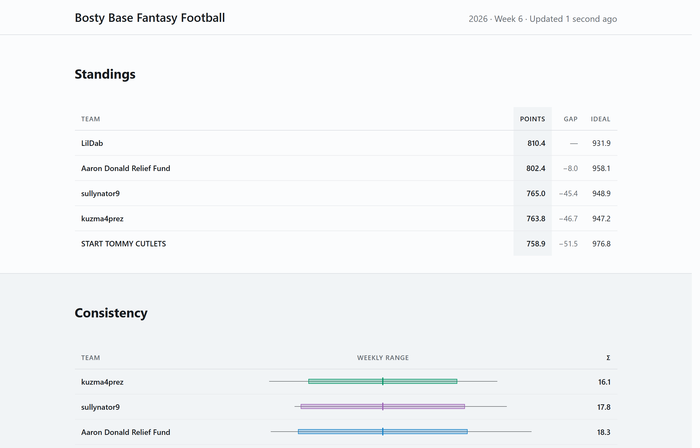

**Contents:** [Goals](#01--goals) · [Constraints](#02--domain-constraints) · [Architecture](#03--architecture-and-tools) · [Features](#04--website-features) · [Problems and solutions](#05--problems-and-solutions)

## 01 · Goals

- **Problem:** My college buddies and I started a fantasy football league. We chose Sleeper as our platform so we could do a week-long draft due to time zone issues. There's an odd number of us, so we decided to compete on total points scored over the year, as opposed to matchups and playoffs. Sleeper's UI made tracking total points over the year challenging, so I wanted to build a website to more easily track the standings over the year. Secondarily, I wanted to track a few other statistics over the year, such as ideal point totals and consistency.
- **Goal:** create a live leaderboard ranked on total points
- **Goal:** measure consistency, measured as σ
- **Goal:** measure ideal points: the sum of the best legal lineup from each week's roster

## 02 · Domain constraints

| Constraint | Target | Result |
|---|---|---|
| Cost | Free tiers; alert at $0.50, budget $1/month | ≈ $0.25/month, measured |
| Sleeper load | Flat, whatever the number of viewers; within Sleeper's ~1,000/min guidance at worst-case scale-out | ≈ 4.4 req/min per instance / hard cap 25/min |
| Freshness | Near-live on Sundays, under a minute | Score ≤ 45 s old |
| Privacy | League and user IDs never public | Kept in secrets and never logged, hashed when stored |

- **Cost:** it is a hobby project, so ideally $0. As you'll see, I eventually took on a very small level of cost, for good reason.
  - *Shapes the design:* leveraged free-tier Azure resources, used serverless everywhere to minimize compute means no idle compute. This did lead to a problem with cold starts. See [cold starts](#cold-start).
- **Requests per minute:** Sleeper is free and has no API key and no SLA. They kindly ask consumers to stay under 1000 requests per minute. 
  - *Shapes the design:* the browser never calls Sleeper directly. Every read goes through the server, so the load is set by the cache TTLs, not by the audience.
  - *Scale-out:* Flex Consumption cannot be capped below 40 instances, and 40 × 25/min = 1,000/min, which is why the per-instance limit is 25. 
- **Real time, roughly:** on a Sunday a score changes about once a minute, and the rest of the week nothing changes.
  - *Shapes the design:* polling every 30 s with ETags instead of websockets ([useSeason.ts](https://github.com/flambeauRiverTours/FantasyFootballWebsite/blob/main/web/src/hooks/useSeason.ts)).

## 03 · Architecture and tools

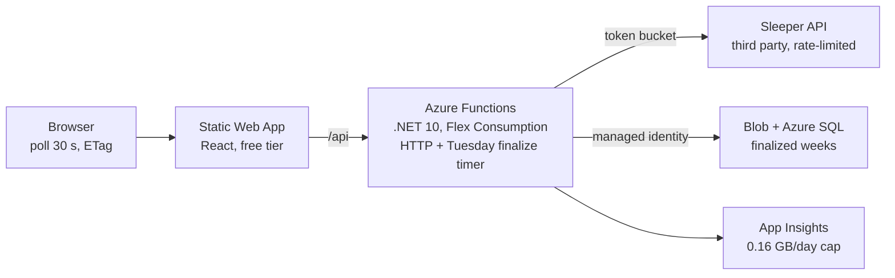

| Layer | Tool | Why this one |
|---|---|---|
| Hosting | Static Web Apps + Azure Functions, Flex Consumption | Both are free at the necessary load. Functions can be triggered via cron scheduling, and custom domains can be used. |
| Backend | .NET 10 isolated, HybridCache, TimeProvider | Selected due to my familiarity with C# |
| Storage | Blob (current season) + Azure SQL serverless (every season), EF Core migrations | This ended up as the sweet spot to minimize cost while maintaining performance |
| Front end | React 19, Vite, TypeScript, D3 | Selected due to my familiarity with React and TypeScript |
| Infrastructure | Bicep, deployed on every release | Bicep is the current standard for Azure |
| CI/CD | GitHub Actions + OIDC to Azure | No stored deploy keys, and I personally prefer GitHub's pipeline syntax |
| Quality | xUnit, vitest, axe-core, oxlint, Prettier, dotnet format | About 400 .NET and 200 web tests |
| Supply chain | CodeQL, NuGet and npm audits, licence allowlist, Trivy, SBOM, SHA-pinned actions | Overkill for this level of project, but good practice |
| Telemetry | App Insights + an alert on exceptions | Ingest is capped to stay inside the free allowance |

- **Layering:** Core ← Sleeper ← Seasons ← hosts (Functions, CLI), with Data beside them (A21, A22). [Browse the projects](https://github.com/flambeauRiverTours/FantasyFootballWebsite/tree/main/src).
  - *Why:* the solver and statistics have no Azure dependency, so they test offline in milliseconds. The CLI host checks the numbers against live data without deploying.
- **The request budget** is enforced by two mechanisms, and the second is the one that guarantees it.
  - *Single-flight cache:* concurrent misses on one key share one fetch, so a cache expiry under load cannot become a thundering herd ([SleeperReader.cs](https://github.com/flambeauRiverTours/FantasyFootballWebsite/blob/main/src/FantasyLeague.Sleeper/SleeperReader.cs)).
  - *Token bucket* inside the `HttpClient` pipeline: a bug or a bad cache key still cannot exceed 25/min, and a 429 backs off with jitter ([ServiceCollectionExtensions.cs](https://github.com/flambeauRiverTours/FantasyFootballWebsite/blob/main/src/FantasyLeague.Sleeper/ServiceCollectionExtensions.cs)).
- **Decision records:** design decisions are D1–D11; every later deviation is an amendment, A1–A34.
  - *Why:* each corrected figure stays next to the original, so the record shows where estimates met measurement.

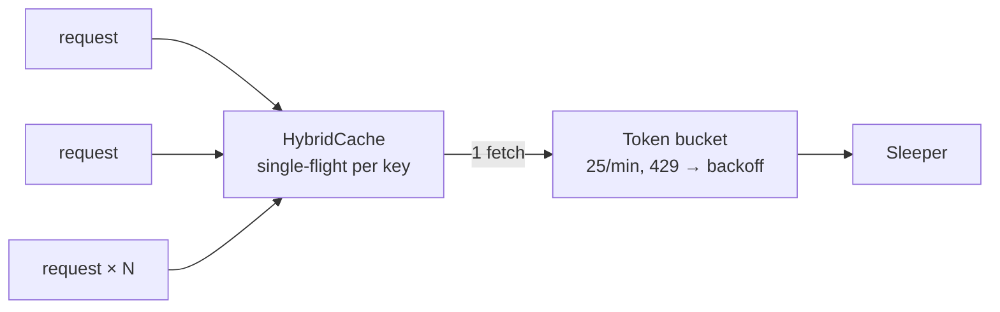

The pipelines: [ci.yml](https://github.com/flambeauRiverTours/FantasyFootballWebsite/blob/main/.github/workflows/ci.yml) · [deploy.yml](https://github.com/flambeauRiverTours/FantasyFootballWebsite/blob/main/.github/workflows/deploy.yml) · [security.yml](https://github.com/flambeauRiverTours/FantasyFootballWebsite/blob/main/.github/workflows/security.yml)

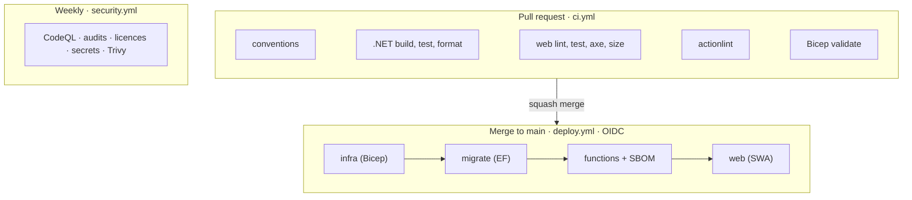

## 04 · Website features

The page has four sections. Most update live on Sundays, and the URL encodes each chart's settings, so a link shares exactly what you are looking at. It follows the system's light or dark theme, and works on a phone.

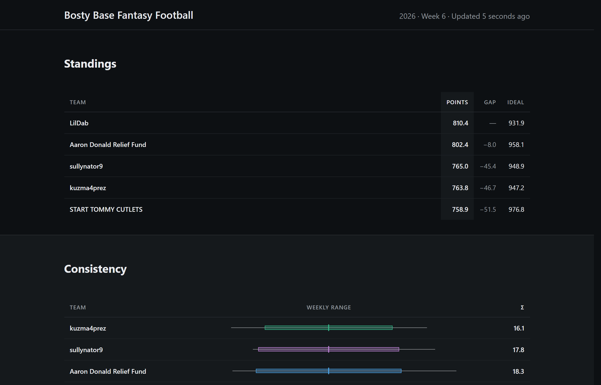 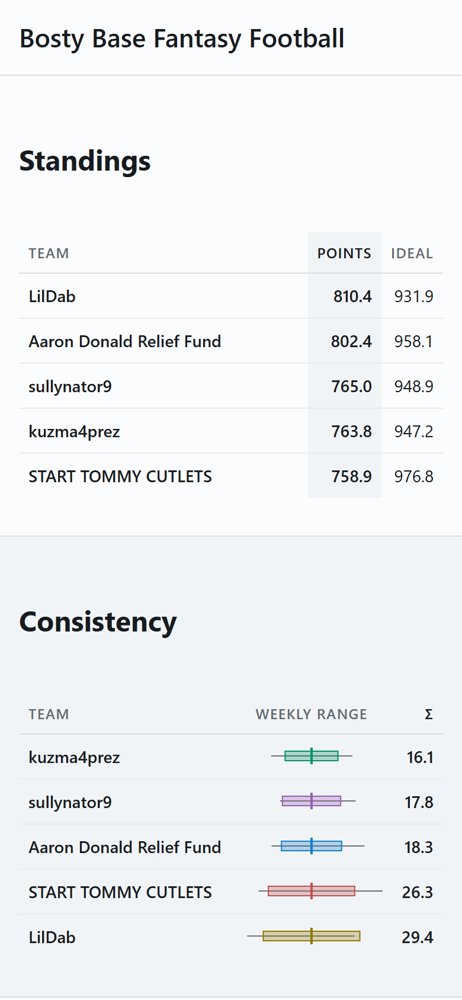

### Standings

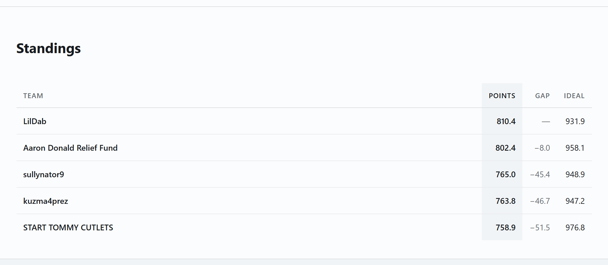

- The leaderboard has one row per team, ranked on total points.
- **Gap** shows how far each team trails the leader. **Ideal** shows the points the team could have scored with the best legal lineup every week (see [ideal points](#ideal-points-calculations---handling-flex-slots)).
- The live week counts toward the total, so the table moves during games.
- Code: [StandingsPanel.tsx](https://github.com/flambeauRiverTours/FantasyFootballWebsite/blob/main/web/src/components/StandingsPanel.tsx)

### Consistency

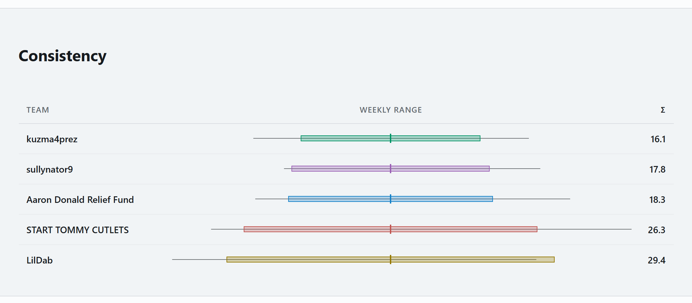

- This section has one row per team, ranked on σ: the standard deviation of that team's finalized weekly scores.
- Beside each σ is a range mark: the team's lowest and highest week, with a band one σ either side of its average. The marks are centred on each team's average, so the widths compare at a glance.
- σ is left blank until four weeks are final as a spread over two or three weeks means nothing.
- Code: [Spread.cs](https://github.com/flambeauRiverTours/FantasyFootballWebsite/blob/main/src/FantasyLeague.Core/Spread.cs) · [ConsistencyPanel.tsx](https://github.com/flambeauRiverTours/FantasyFootballWebsite/blob/main/web/src/components/ConsistencyPanel.tsx)

### Chart

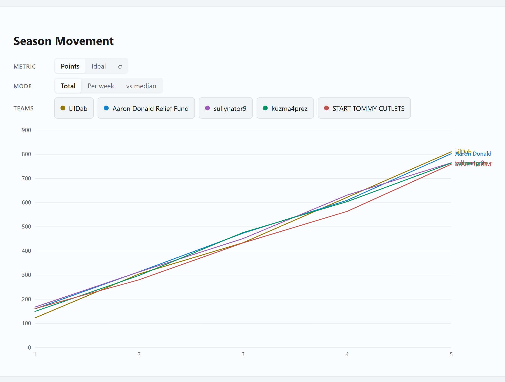

- A week-by-week line chart for any teams you pick, showing **Points**, **Ideal** or **σ**.
- For points and ideal, there are three views: running **Total**, **Per week**, and **vs median** (points above or below the league median, summed over the weeks). The median view shows who is pulling away, which a running total hides.
- For σ, there are two choices: **Expanding** (all weeks so far) or **Rolling 4** (the last four weeks)
- Code: [ChartPanel.tsx](https://github.com/flambeauRiverTours/FantasyFootballWebsite/blob/main/web/src/components/ChartPanel.tsx)

### Positional radar

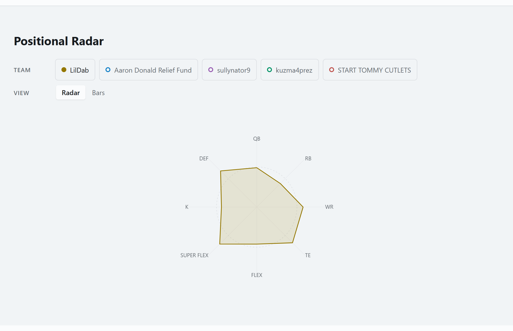

- Shows, for one team at a time, how its average at each starting slot (QB, RB, WR, FLEX and so on) compares with the league average at that slot.
- Every axis is a ratio to the league average, centred on 1.0.
- A **Bars** view shows the same numbers as a bar chart that diverges from 1.0, which is easier to read exactly than a radar's shape.
- Code: [SlotAverager.cs](https://github.com/flambeauRiverTours/FantasyFootballWebsite/blob/main/src/FantasyLeague.Core/SlotAverager.cs) · [RadarPanel.tsx](https://github.com/flambeauRiverTours/FantasyFootballWebsite/blob/main/web/src/components/RadarPanel.tsx)

## 05 · Problems and solutions

### Cold start

**Problem**
- The free SQL tier requires auto-pause. Running continuously would use about 1.3M vCore-seconds a month against an allowance of 100k. A paused database takes 30 to 60 s to resume, so the first visitor after an idle hour waited an unacceptable amount of time for the website to load. I found this frustrating during the development process, so there was no way I could ship the site with that load time.

**Rejected Solutions**
- *Cache more.* This would result in a degradation in the real-time updating of the statistics, and wouldn't fully solve the problem, as the first user to hit an invalidated cache would still get the 30-60s wait.
- *A keep-warm ping during high-traffic hours.* Even limiting to ~10 hours per day this would have blown through the free-tier allowance.
- *Drop SQL entirely for blob storage.* This would have worked, but would have required a signficant rewrite, and while blob is extremely cheap on the scale I'm using, it isn't free. Plus, I wanted to practice working with EF.

**Selected Solution**
- I decided to mirror the current season's finalized weeks to blob storage. The read path checks memory, then blob, then SQL if the blob isn't populated for some reason (though this was only encountered during the initial deploy of this architecture). See [FinalizedWeekStore.cs](https://github.com/flambeauRiverTours/FantasyFootballWebsite/blob/main/src/FantasyLeague.Data/FinalizedWeekStore.cs).
- The only SQL traffic left is the Tuesday finalization job that writes the week's data, isn't a user-facing workflow. On deploy, however, I found that cold starts continued occurring. It turns out the blob was only being written by the Tuesday job, so I added writing the blob on user requests if they found no blob entry.
- To further mitigate any performance issues, on the front end the loading state changes to "Waking the database…" after 3 seconds for the rare case that still waits.
- I now see 2-7 second cold load time - this latency comes from new server instances, and can't be solved with a simple storage swap.
- This adds some trivial cost for blob storage. Total monthtly cost for the site is still around $0.25 per month.

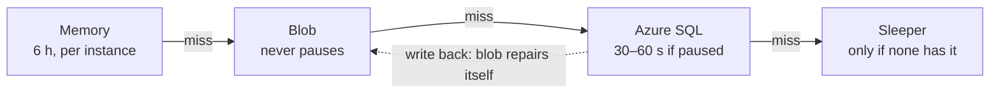

### Ideal points calculations - handling flex slots

**Problem**
- Solving the ideal lineup for a given week means filling the starting lineup slots with the combination of players that produces the highest value for the week. Some slots (flex, superflex) allow multiple player positions.
- A greedy assignment (best player into the first open slot) undercounts whenever a flex slot exists.
- Sleeper does not expose this value via their API, though it is available in their app.

**Solution**
- I solved this with a [bitmask DP](https://dilipkumar.medium.com/bitmasking-dynamic-programming-coding-pattern-789030c04cd8), where the DP state is a bitmask of which lineup slots are filled. For each player in turn, it tries placing them into every empty slot they’re eligible for and keeps the best total for each set of filled slots. 11 slots means 2¹¹ = 2,048 states and roughly 450k operations per team-week, which takes on the order of a millisecond. See [IdealLineupSolver.cs](https://github.com/flambeauRiverTours/FantasyFootballWebsite/blob/main/src/FantasyLeague.Core/IdealLineupSolver.cs).
- I briefly considered brute force here for simplicity, but this would have required on the order of 20!/9! permutations, likely taking two hours or so per calculation. 

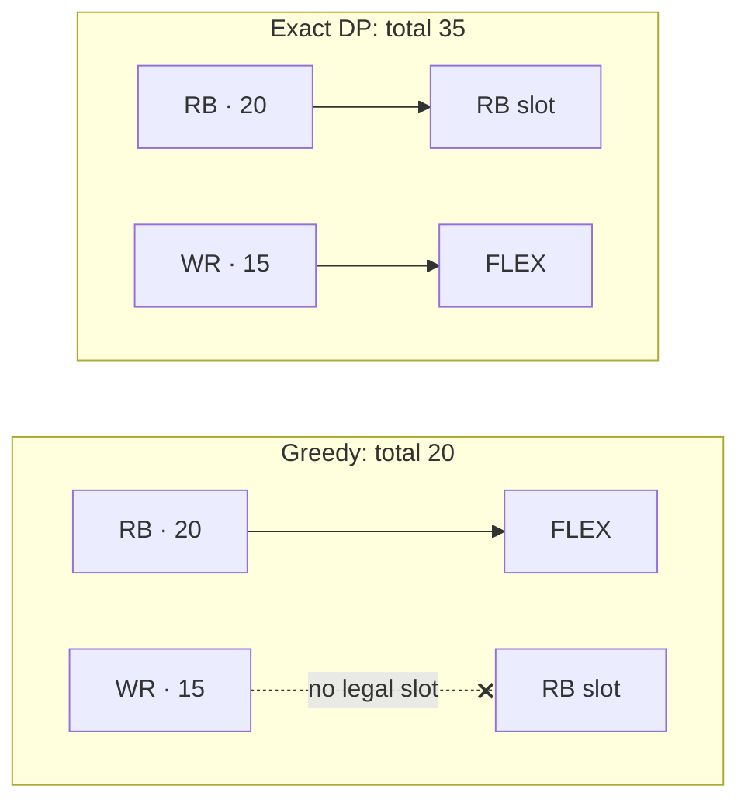

### Season rollover: every year is a new league

**Problem**
- Sleeper gives each season a new league ID every year. Hard-coding a league ID would break, and I wanted to keep the league ID out of the source code for privacy reasons. But, I wanted historical data to be available too.

**Solution**
- Sleeper provides a `previous_league_id` when querying a league, so we could chain-walk back via this field to get a list of historical league IDs. This is cached for 24 hours as this could in the future involve a good chunk of API calls. See [SeasonChain.cs](https://github.com/flambeauRiverTours/FantasyFootballWebsite/blob/main/src/FantasyLeague.Seasons/SeasonChain.cs).
- Sleeper doesn't provide a `next_league_id` field, so we can't automatically get a new season's league IDs. Thus, a manual rollover is needed.

### Limitations

- **No support for matchups:** should we one day decide to return to a typical matchup and playoff league structure, a significant rework will be needed to support this.
- **Season rollover** has not been tested on a live league.
- **Single tenant:** this is currently just for my league. Expanding to other leagues would bring a whole host of problems to solve. Much of the data (e.g, player scores for a week) could be shared between leagues, and a Redis cache could be used to share this between leagues to reduce load on the Sleeper API. We'd also likely need to move away from polling to server-sent events (not websockets, as this only needs to be a one-way communication), as polling would scale requests with the number of tenants.

### AI Usage

- AI was of course used in the creation of this site, primarily Claude Code. This project allowed me to try out various agentic coding workflows on a low-stakes project, to develop workflows for further projects. I primarily delegated test writing and boilerplate/formulaic code writing to AI, as well as updating task lists and designs. I reviewed any generated code prior to committing it. Generally I found AI to be a capable tool, and it was a huge help for a side project like this - I could not write all the required code for a project of this size by hand in my evenings and weekends. 

---

<!-- Pages' Jekyll does not render Mermaid; github.com does. This turns the fenced blocks into diagrams. -->

